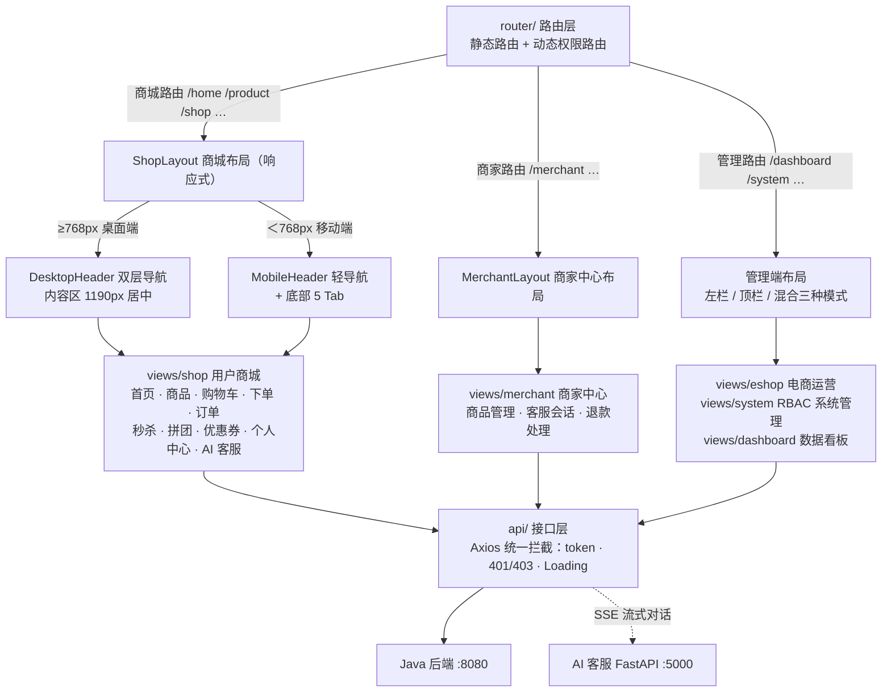

<div align="center">

# E-Shop 电商系统（前端）

**基于 Vue 3 + TypeScript + Element Plus 的三端电商前端：用户商城 · 商家中心 · 管理后台**

[](https://vuejs.org/)
[](https://www.typescriptlang.org/)
[](https://vitejs.dev/)
[](https://element-plus.org/)
[](https://pnpm.io/)

</div>

> 基于 [vue3-element-admin](https://gitee.com/youlaiorg/vue3-element-admin) 二次开发的电商前端。

## 项目仓库导航

| 项目 | 仓库地址 |
|------|----------|
| 🖥️ **前端（本项目）** | [Eshop_front](https://github.com/shuxinwu718-web/Eshop_front) |
| ☕ **后端（Java）** | [Eshop](https://github.com/shuxinwu718-web/Eshop) |
| 🐍 **AI 客服服务（Python）** | [ai-customer-service](https://github.com/shuxinwu718-web/ai-customer-service) |

> 包含**用户商城（shop）**、**商家中心（merchant）**、**系统管理（system）** 三端，以及拼团、秒杀、优惠券、AI 客服等特色功能。
>
> 三端布局各自独立：商城使用专属电商布局 `ShopLayout`（顶部导航 + 购物车/消息徽标），商家中心与管理后台沿用管理端布局；管理员可自由切换商城与管理后台视角。
>
> 商城端采用**响应式双布局**（`useIsMobile` 按 <768px 断点实时切换，不依赖 UA）：
> - **桌面端**（≥768px）：京东式电商网页，内容区 1190px 居中、双层头部导航 + 首页分类栏，商品网格 + 分页
> - **移动端**（<768px）：App 风格，顶部轻导航 + 底部 5 Tab（首页 / 秒杀 / 购物车 / 活动 / 我的），首页双列瀑布流 + 上拉加载；窗口缩放至断点可即时切换且 keep-alive 页面状态不丢失

## 功能亮点

- **秒杀系统**：秒杀=抢下单资格（单次点击不拖慢抢购），抢到立即弹收银台 PayDialog 选微信/支付宝，30 分钟内可补付；商品与优惠券分 Tab 展示；消费端经 JWT + Redis 限流防刷
- **支付宝沙箱支付**：下单支付走真实沙箱 channel，`/pay/result` 回跳页展示结果并结合异步对账自愈（reconcilePaidOrder）
- **拼团/团购**：商品详情 GroupBuyPanel 展示进行中团（按剩余名额紧迫度排序）、发起/加入拼团，可多层拼团
- **优惠券体系**：领券中心 + 我的券 + 节日签到活动券，每日签到双入口（顶栏 + 首页搜索栏）
- **AI 客服**：浮球 + 引导气泡 + 消息面板（SSE 流式打字机输出），商品推荐/搜索类问题优先走真实数据工具，FAQ 兜底
- **关系型搜索双引擎**：ES 开关控制，关闭自动降级 MySQL 搜索，默认 id 升序
- **移动端商品详情**：全宽图集 + 价格卡片 + 半屏规格抽屉 + 底部固定操作栏（收藏/客服/加购/立即购买），隐藏商城 Tab 用专属 Dock
- **收货地址级联**：AddressPicker 底部弹层 + 单列递进选择省市区，替代 el-cascader 适配窄屏
- **消息通知 + 站内信**：顶栏铃铛实时未读徽标（SSE/轮询），支持全部已读
- **管理端监控与访问日志**：系统监控页 + 访问日志列表，高频轮询接口自动打入噪声排除，不虚高 PV/UV

## 技术栈

| 类别 | 技术 |
| --- | --- |
| 核心框架 | Vue 3.5、TypeScript 5.9、Vite 8 |
| UI 组件 | Element Plus 2.13、UnoCSS、ECharts 6、vxe-table |
| 状态/路由 | Pinia、vue-router 5、vue-i18n |
| 请求 | Axios（统一拦截器、401/403 登录策略、Loading 管理） |
| 富文本/编辑 | WangEditor、CodeMirror |
| 工程化 | pnpm、husky、eslint、prettier、stylelint、commitlint |

## 系统架构

一套代码承载三个角色入口，由路由层分发到独立布局，页面按业务域组织：



## 项目结构

> 通用组件统一「文件夹 + index.vue」规范；页面按「业务域」分目录，一个业务域内部再拆组件（如商品详情拆出图集、SKU 选择器、拼团面板等）。

```
Eshop
├─ public/                          # 静态资源（构建时原样拷贝）
├─ src/
│  ├─ main.ts                       # 应用入口：注册插件 / 全局组件 / 路由 / 守卫
│  │
│  ├─ router/                       # ── 路由 ──
│  │  ├─ index.ts                   #   路由表：静态路由 + 动态路由装配
│  │  └─ guards/                    #   路由守卫：登录鉴权 / 动态权限校验
│  │
│  ├─ layouts/                      # ── 布局外壳（三端各自独立）──
│  │  ├─ index.vue                  #   布局分发器：按路由选择 Shop / Merchant / 管理端
│  │  ├─ ShopLayout.vue             #   ★ 商城布局：响应式双布局 + 设置抽屉 + 悬浮球统一挂载
│  │  ├─ MerchantLayout.vue         #   商家中心布局
│  │  ├─ shop/                      #   商城布局零件：DesktopHeader / MobileHeader / MobileTabBar
│  │  └─ components/                #   管理端布局零件：侧边栏 / 导航栏 / 标签页 / 主题设置
│  │
│  ├─ views/                        # ── 页面（按业务域分目录）──
│  │  ├─ shop/                      #   ★ 用户商城（C 端）
│  │  │  ├─ home/ product/          #     首页 · 商品详情（图集/SKU/拼团面板/评论区等子组件）
│  │  │  ├─ cart/ checkout/ order/  #     购物车 · 结算 · 订单（PayDialog 收银台）
│  │  │  ├─ seckill/ groupBuy/      #     限时秒杀 · 拼团
│  │  │  ├─ coupon/ activity/       #     领券中心 · 签到/节日活动
│  │  │  └─ member/ center/ …       #     我的 · 个人中心 · 收藏 · 地址 · 客服 · 消息 · 店铺
│  │  ├─ merchant/                  #   商家中心（B 端）：商品管理 · 客服会话 · 入驻申请
│  │  ├─ eshop/                     #   管理后台-电商运营：商品/订单/用户/优惠券/秒杀/退款审核/监控
│  │  ├─ system/                    #   管理后台-系统管理：用户/角色/菜单/部门/字典/租户/日志
│  │  ├─ dashboard/                 #   数据看板（管理端首页）
│  │  └─ login/ profile/ chat/ …    #   登录注册 · 个人资料 · IM 聊天 · 异常页
│  │
│  ├─ api/                          # ── 接口层（与后端 Controller 一一对应）──
│  │  ├─ eshop/                     #   电商业务接口：product/order/cart/seckill/coupon…
│  │  ├─ system/                    #   系统管理接口：user/role/menu/dict…
│  │  └─ ai/chat.ts                 #   AI 客服接口（含 SSE 流式请求）
│  │
│  ├─ store/modules/                # ── Pinia 全局状态 ──
│  │  ├─ user.ts / permission.ts    #   登录态 · 动态路由权限
│  │  ├─ cart.ts                    #   购物车（数量徽标跨页共享）
│  │  └─ settings.ts / app.ts …     #   个性化设置 · 应用配置 · 标签页 · 字典 · 租户
│  │
│  ├─ components/                   # ── 全局通用组件 ──
│  │  ├─ Upload/ CURD/ Pagination/  #   后台通用：上传 · 增删改查套件 · 分页 · 表格工具
│  │  ├─ AddressPicker/ EmptyState/ #   商城通用：省市区级联 · 统一空状态 · 骨架屏
│  │  └─ CustomerServiceFab/ …      #   AI 客服浮球 · 个性化设置抽屉 · 版本公告横幅
│  │
│  ├─ composables/                  # ── 组合式函数 ──
│  │  ├─ useIsMobile.ts             #   响应式断点（移动/桌面双布局实时切换）
│  │  ├─ useExport.ts …             #   Excel 导出 · 表格多选 · 最近菜单
│  │  └─ sse/                       #   SSE 实时通道：站内信 / 在线人数 / 发布公告 / 字典同步
│  │
│  ├─ hooks/ directives/ utils/     # 通用逻辑：Hooks · 权限指令 · 工具库（request/auth/theme/format…）
│  ├─ styles/                       # 全局样式：设计令牌（圆角/品牌色/背景变量）+ 三方库覆写
│  ├─ assets/ types/ lang/ config/ constants/ enums/ plugins/   # 静态资源 · 类型 · 国际化 · 全局配置
│  │
│  └─ …
├─ .env.development                 # 开发环境变量（代理前缀 /dev-api、/ai）
├─ .env.production                  # 生产环境变量（/prod-api）
├─ vite.config.ts                   # Vite 配置：代理 · 自动导入 · 构建压缩
└─ package.json
```

## 快速开始

### 环境要求

- Node.js `^20.19.0 || >=22.12.0`
- 包管理器 **pnpm**（项目通过 `only-allow` 强制使用 pnpm）

### 方式一：本地开发（配合本地后端）

需先按后端仓库 README 起动后端（本机 `8080`；AI 客服在 `5000`，可选），再：

```bash
# 1. 安装依赖
pnpm install

# 2. 启动开发服务（默认 http://localhost:3000）
pnpm dev
```

开发代理（见 `.env.development` 与 `vite.config.ts`）：

| 前缀 | 转发到 | 说明 |
|---|---|---|
| `/dev-api` | `http://localhost:8080` | 后端，去前缀（`VITE_APP_API_URL`） |
| `/ai` | `http://localhost:5000` | AI 客服 FastAPI |
| `/uploads` | `http://localhost:8080` | 上传图片静态资源 |

> 联调即「后端先起 + 前端 `pnpm dev`」，默认端口后端 8080 / 前端 3000 / AI 5000。

### 方式二：Docker 部署（配合后端生产 compose）

生产前端**不做独立部署**，而是把构建产物挂进后端 `docker-compose.prod.yml` 的 `frontend`（nginx）容器：

1. **确认 `.env.production`**：

| 变量 | 生产值 | 说明 |
|---|---|---|
| `VITE_APP_BASE_API` | `/prod-api` | nginx `/prod-api/` 转发后端并去前缀 |
| `VITE_APP_TENANT_ENABLED` | `false` | 需与后端一致 |

2. **构建并上传**：

```bash
pnpm build
# dist/ → 服务器 /opt/eshop/frontend/dist/
# nginx.conf → 服务器 /opt/eshop/frontend/
```

3. **由后端 compose 统一启动**（详见后端 README「方式三」）：

```bash
cd /opt/eshop
docker compose -f docker-compose.prod.yml up -d --build
```

访问 `http://<服务器IP>`（nginx :80；`/prod-api` → 后端、`/uploads` → 图片、`/ai` → AI 客服）。

## 常用脚本

| 命令 | 说明 |
| --- | --- |
| `pnpm dev` | 启动开发服务器 |
| `pnpm build` | 生产构建（terser 压缩，自动移除 console/debugger） |
| `pnpm preview` | 预览构建产物 |
| `pnpm type-check` | TypeScript 类型检查（vue-tsc） |
| `pnpm lint` | eslint + prettier + stylelint 全量检查与修复 |
| `pnpm commit` | git-cz 交互式提交（规范 commit message） |

## 代码规范

- **Pre-commit**：husky + lint-staged，提交时自动执行 eslint / prettier / stylelint 并修复
- **Commit message**：commitlint 校验 Conventional Commits 格式
- **组件规范**：通用组件统一存放于 `src/components`，遵循「文件夹 + index.vue」结构

## License

肇庆学院
