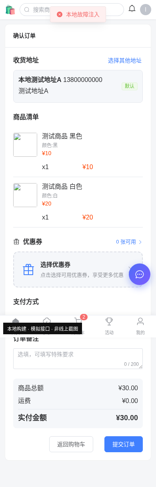
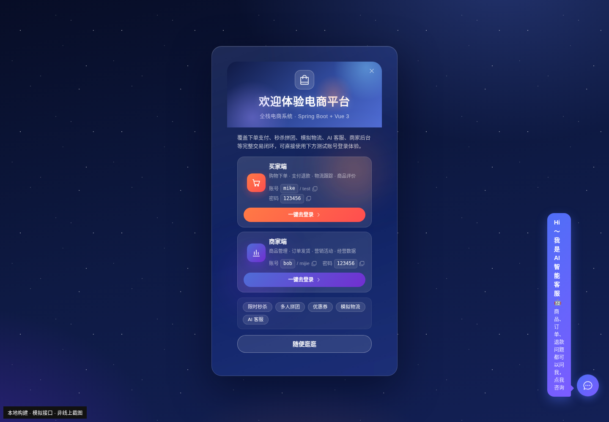
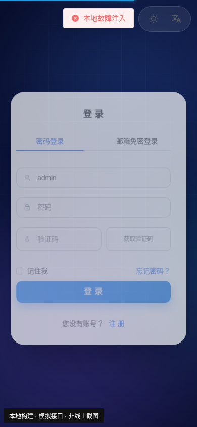

# E-Shop 网站点评与体验检查

评审日期：2026-10-26（北京时间）  
目标网址：<http://120.24.51.10>  
审阅代码：`76f337df94596262073c13eaec24fd622627ef0d`  
报告状态：**阶段性点评；线上访问受当前评审环境的网络策略限制，尚未完成线上验收。**

## 先说结论

这个项目已经有比较清楚的作品定位：买家、商家、管理员三个角色，加上秒杀、拼团、优惠券、物流和支付，适合作为全栈电商作品展示。欢迎弹窗提供角色入口和演示账号，移动端也专门做了布局，而非简单把后台页面缩小，这两点值得保留。

接下来最值得投入的不是继续增加功能，而是把已有流程做准确、做顺畅。本次本地复现发现：**只勾选一个商品规格，结算页却会把同商品的另一个规格也算进去**；“选择其他地址”也没有形成选择后返回结算的闭环。这类问题比颜色、动效更影响项目的可信度。

视觉上，登录页结构清晰，手机宽度适配正常；欢迎页有识别度，但客服提示气泡的宽度和层级有明显问题。异常处理还需要统一：请求失败、没有商品、服务暂不可用应呈现不同状态。

**这里不提供“线上网站总分”**：没有成功连接线上服务、登录后台、浏览真实商品，也未测量线上性能，给完整分数容易误导。以下结论仅适用于已注明的证据范围。

## 本次到底检查了什么

| 项目 | 方法 | 结果与边界 |
| --- | --- | --- |
| 访问部署地址 | 对目标地址发送 HTTP HEAD 和 GET 请求 | 当前环境代理返回 `403 Forbidden`，响应正文为 `Domain forbidden`，`server: envoy`。这是评审环境访问受限的证据，**不能据此判断网站宕机或网站自身返回 403**。 |
| 线上买家、商家、管理员登录 | 未执行 | 网络访问未放行，没有向目标站点提交账号密码。管理员凭据不写入报告或附件。 |
| 页面外观与交互 | Chromium 加载同一代码提交对应的本地生产构建 | 检查桌面 `1440×1000`、手机 `390×844`；使用受控模拟接口检查注册入口、空列表、接口失败、价格筛选、规格结算、地址选择、支付结果缺参。**不是线上实测。** |
| 无后端时的表现 | 本地构建连接不可用接口 | 观察到多条相同错误提示叠加，部分异步错误未被页面捕获；不将本地接口不可用当作生产故障。 |
| 类型检查 | 2026-10-26 重新执行 `pnpm type-check` | 退出码 `2`，共 `91` 项 `error TS` 诊断（[完整输出](assets/2026-10-26/type-check.txt)）；这是代码检查失败，不代表每条错误都是可见运行故障。 |
| 生产构建 | 使用环境初始化时、同一提交已生成的 `dist` | 2026-10-23 构建成功，约 74 秒；本次用该产物进行浏览器复现，未声称这是今天重新构建或线上版本。 |
| AI 客服 | 按项目所有者提供的信息处理 | API key 已过期，生成回复不可用是已知限制；不计作本次新发现，不进行生成请求测试。 |
| 真实数据变更、支付与压测 | 未执行 | 没有创建真实订单、支付、退款、发货、删除或修改真实数据，没有进行负载测试。 |

本地业务复现使用两条人工购物车数据、两个人工地址和本地模拟身份，接口请求在浏览器中被拦截处理；没有使用这些数据访问真实后端。模拟接口拒绝非 GET 请求。原始观察记录见 [复现结果 JSON](assets/2026-10-26/local-results.json)。

## 做得比较好的地方

1. **演示入口清楚。** 欢迎弹窗把买家和商家分开，用一句话解释各角色能做什么，比只放账号密码更利于第一次体验。管理员信息没有出现在该弹窗配置中。
2. **移动端有独立的信息组织。** 首页改用分类横滑、快捷入口、双列商品和底部导航；商品详情也有专门的底部操作区。代码层面的布局方向符合商城使用习惯。
3. **登录页有稳定的视觉骨架。** 桌面品牌区与表单分工清楚，手机隐藏大面积品牌区后表单仍可正常阅读。本地 `390px` 宽度下，文档宽度也是 `390px`，未观察到横向溢出。
4. **游客可以先浏览。** 路由守卫允许公开页面，并在需要登录时提示和保留返回路径，设计上比进入网站就要求登录更友好。
5. **部分交易细节已有考虑。** 结算优惠金额取自后端接口的计算结果；支付结果以服务端查询状态判断，而非只相信回跳参数；支付结果页有定时查询和订单页入口。这些设计应在修复边界问题时保留。

## 优先处理的问题

优先级含义：P1＝先修交易流程或关键操作；P2＝近期修复的体验和工程质量问题。这里的优先级是修复顺序，不是对线上事故严重性的判定。

### 01 · P1 · 同商品不同规格会被一并带入结算

**证据：本地模拟接口复现 + 源码确认。**

- 准备同一 `productId=42` 的两条购物车行：黑色 `skuId=101`，单价 ¥10、已勾选；白色 `skuId=102`，单价 ¥20、未勾选。
- 购物车跳转时只传 `productId`：`/checkout?ids=42`。
- 结算页按 `productId` 过滤，所以两条规格都会保留。本地页面展示黑色和白色，实付 **¥30.00**，而用户选择的商品应只有 **¥10.00**。
- 本次停留在确认订单页，没有点击提交订单。未验证生产下单结果或后端最终校验。

位置：[购物车 checkout](../../src/views/shop/cart/index.vue#L241)、[结算页 fetchCart](../../src/views/shop/checkout/index.vue#L231)。

**建议：** 传购物车行的唯一 ID，或同时传 `(productId, skuId)`，结算展示、创建订单和购物车移除都使用同一套身份。不要只在页面上隐藏另一行，后续提交范围也必须一致。

**验收：** 同商品两规格只选其一，结算仅出现所选行、总额正确；两行都选时才合并计算；提交后只移除实际购买的行。

### 02 · P1 · “选择其他地址”进入地址管理，缺少选中返回

**证据：本地模拟接口复现 + 实际路由对应组件确认。**

结算页的按钮跳转 `/shop/address?select=true`。实际路由映射到 `src/views/eshop/address/index.vue`，不是名称相似的 `src/views/shop/address/index.vue`。当前映射页面有地址列表、导出、新增、编辑、删除，但没有处理 `select=true`，也没有“使用此地址”或携带地址 ID 返回结算的交互。结算页初始化又优先取默认地址。

这使“本次订单临时使用非默认地址”缺少直接完成路径。不要靠要求用户更改全局默认地址来代替本次订单选择。

位置：[结算页 selectAddress](../../src/views/shop/checkout/index.vue#L260)、[地址页路由](../../src/router/index.ts#L518)、[实际地址页](../../src/views/eshop/address/index.vue)。

**建议：** 为选择模式显示“使用此地址”，返回选中 `addressId`，并保留结算商品、优惠券和备注；地址管理模式继续保留编辑功能。顺便梳理两个地址页的用途，避免改到未被路由使用的文件。

**验收：** 默认地址 A、非默认地址 B，从结算进入选择 B 后，结算显示 B，且不会修改全局默认地址或丢失所选规格。

### 03 · P2 · 商城“注册”入口打开的是登录表单

**证据：本地浏览器复现 + 源码确认。**

点击桌面顶栏“注册”后进入 `/login`，选中的是“密码登录”，标题为“登 录”。首页游客卡片的“注册”也同样跳转。登录页面的注册切换虽存在，但需要用户再找一次。

位置：[DesktopHeader](../../src/layouts/shop/DesktopHeader.vue#L63)、[首页游客卡片](../../src/views/shop/home/index.vue#L279)、[登录页初始表单](../../src/views/login/index.vue#L73)。

**建议与验收：** 使用明确的注册入口状态，例如 `?mode=register`，登录容器读取并展示注册表单；分别验证顶栏入口和首页入口，点击一次即可开始注册。

### 04 · P2 · 客服引导气泡在桌面端变成竖条，并盖在欢迎层上

**证据：本地浏览器复现和截图。**

在 `1440×1000` 视口中，首次进入时气泡实际宽度约 **56px**、高度约 **435px**，中文几乎逐字换行。客服浮层设置 `z-index:9999`，欢迎弹窗打开时它仍显示在外侧。

位置：[CustomerServiceFab 样式](../../src/components/CustomerServiceFab/index.vue#L131)。提示气泡仅设置 `max-width`，缺少明确合适的宽度；绝对定位下的实际可用空间导致了此处收缩。

**建议：** 指定气泡宽度并限制到可视区，例如 `width:min(240px, calc(100vw - 100px))`，结合实际位置验证；在欢迎弹窗打开时延后显示客服引导，统一弹层层级。考虑 `prefers-reduced-motion`，降低持续悬浮动效对阅读的干扰。

**验收：** 桌面提示能按正常句子阅读；手机不出屏；欢迎层打开时只保留一个主要引导。

### 05 · P2 · 请求失败和“没有商品”混用同一个状态

**证据：本地空接口与 503 故障注入分别复现。**

手机首页在空数据时显示“— 没有更多了 —”；模拟商品搜索接口返回 503 后，页面仍显示同一句话。用户无法知道是搜索结果为空，还是服务临时失败。无后端场景还会出现多条重复的“请求失败”提示，遮挡主要内容。

位置：[首页异常分支](../../src/views/shop/home/index.vue#L512)、[手机列表状态](../../src/views/shop/home/index.vue#L148)、[请求拦截器](../../src/utils/request.ts)。

**建议：** 区分初次加载、成功但无结果、加载失败、分页失败和全部加载完成；为失败提供原位重试，保留已有商品列表；全局错误做短时间去重，非关键轮询不要反复打断用户。

**验收：** 无商品显示清晰的空态和重置筛选；服务失败显示重试入口；已有商品的下一页失败时不能让用户误以为真的没有更多。

### 06 · P2 · 价格筛选没有基础范围校验

**证据：本地拦截请求参数复现。**

最低价填 `200`、最高价填 `100`，页面直接发送 `minPrice=200&maxPrice=100`；最低价填 `-5` 也直接发送。手机输入为数字类型并不能解决数值关系校验。

位置：[applyFilter](../../src/views/shop/home/index.vue#L595)。

**建议与验收：** 提交前检查有限数值、非负、最低价不大于最高价；错误就近提示且不发请求。空输入仍应表示不限制，不要自动变成 0。

### 07 · P2 · 支付结果页缺少明确的“查询无结果／查询超时”结束状态

**证据：缺参状态做本地浏览器复现；轮询超时部分为源码审阅，未支付。**

页面的 `pending` 根据 `queryVO` 判断，没有排除 `missing`。缺少订单参数时标题变成“未找到支付记录”，图标仍可能保持等待动画；查单失败的 `catch` 不更新错误状态，超过 20 次定时触发停止轮询后，也没有对应的超时提示。

位置：[支付结果状态计算](../../src/views/shop/pay/result.vue#L53)、[查询与轮询](../../src/views/shop/pay/result.vue#L68)。

**建议：** 建立 `querying / paid / closed / missing / queryFailed / timedOut` 等明确状态；停止查询时说明原因，给“重新查询”和“查看订单”。不要把暂时查不到结果展示成已支付或支付失败。

**验收：** 无订单参数时不转圈；查单超时后有可恢复的说明；支付成功只能由服务端状态确认。

### 08 · P2 · 演示账号密码被放入页面 URL

**证据：源码确认。**

欢迎弹窗的“一键去登录”把 `username` 和 `password` 放入登录路由 query，登录组件再读取。当前是 hash 路由：fragment 通常不会随常规 HTTP 请求发送给服务器，因此不能直接断言它已出现在 Nginx 访问日志里；但它会出现在浏览器地址栏、历史记录以及用户复制的完整链接中，也可被页面脚本读取。

位置：[欢迎弹窗 goLogin](../../src/components/WelcomeDialog/index.vue#L177)、[Login.vue 预填](../../src/views/login/components/Login.vue#L177)。

**建议：** 路由仅传演示角色或账号标识，由临时状态完成演示预填；不要把真实凭据写进 URL。本报告不复述管理员密码，附件也不包含管理员凭据。

**验收：** 点击欢迎引导后地址栏没有密码字段；演示仍可按预期完成；真实账号不经过该预填机制。

### 09 · P2 · 构建能过，但类型检查有 91 项错误

**证据：本次重新执行 `pnpm type-check`，退出码 2。**

错误涉及上传组件的 `defineModel` 默认值与类型、表格 `DefaultRow` 与业务实体不一致、必填属性被 `delete`、以及 `GroupBuyPanel.vue` 引用不存在的 `@/api/address`。Vite 构建成功不能代替类型检查通过；某些未使用文件仍会被类型检查覆盖，也不能把所有诊断直接等同于线上页面故障。

建议先整理重复/未使用页面和组件，再修公共上传与表格类型，最后收敛业务页面错误。给项目补一组能覆盖“购物车规格 → 结算 → 地址选择”的回归检查，比继续堆功能更有价值。

**验收：** `pnpm type-check` 返回 0，实际检查到源文件；构建和上述关键流程回归也通过，不能靠排除目录或关闭检查来归零。

## AI 客服已知不可用时，页面怎么表现更好

你已说明 API key 过期，所以这里不把“AI 没回复”当成新缺陷，也没有尝试获取或更换 key。

目前欢迎说明和悬浮气泡仍积极引导用户咨询。建议临时显示“AI 客服维护中”，保留订单、退款等静态 FAQ 和已有商家沟通入口，让用户在点击前就能知道可用范围。客服页已经有失败回复兜底，不必把整个页面删掉；关键是服务状态应贯穿入口、欢迎说明和会话页。

验收时分别检查：服务可用、服务维护、网络超时；技术密钥只在服务端安全配置中维护，不进入前端代码或报告。

## 外观和产品表达建议

- **保留登录页风格，统一到商城。** 深蓝品牌页和商城的布局方向各自合理，可以通过统一的品牌色、按钮圆角、字重和间距建立联系。先修客服气泡，不急着整体重做页面。
- **欢迎页强调“体验路线”。** 买家入口下给出“浏览商品 → 选择规格 → 下单 → 查看物流”的短路线；商家入口给出“查看商品 → 查看订单 → 经营数据”。对于模拟物流、模拟微信支付、支付宝沙箱，应在真正操作的位置继续说明。
- **不要把演示承诺当正式运营承诺。** 登录页有“假一赔十”“次日送达”等营销语。若项目主要用于展示，建议明确演示性质，避免让初次访问者误以为这里承诺真实履约。
- **支付方式命名保持一致。** 结算页显示“微信支付”，收银台才标“微信支付（模拟）”；最好在选择支付方式的第一步就说明模拟/沙箱范围。未执行付款，支付能力仍需线上验收。
- **改善键盘操作。** 首页分类、排序、商品卡和部分图标主要使用 `div/span + @click`。建议可操作元素优先使用按钮/链接，提供可见焦点和易理解名称。这里是代码审阅建议，未声称完成完整无障碍审计。

## 修复顺序建议

| 顺序 | 要做的事 | 完成标准 |
| --- | --- | --- |
| 第一批 | 修结算规格范围、地址选择闭环 | 单规格勾选金额准确，非默认地址可选回，并保留结算上下文 |
| 第二批 | 注册入口、客服气泡、错误/空态、价格校验 | 用户入口直达目标；无挤压；失败可重试；非法条件不发送 |
| 第三批 | 支付结果状态、AI 维护提示、URL 凭据处理 | 所有结果都有明确状态，已知不可用服务提前说明，地址栏无密码 |
| 持续补齐 | 类型检查和关键流程回归 | 类型检查通过，规格与地址流程有稳定回归覆盖 |

## 线上访问恢复后，还需要补哪些验收

当前环境的网络配置草稿已添加 `120.24.51.10`，需要在环境设置保存后，重新验证目标访问是否放行。此前的 `403 Domain forbidden` 不代表已测试网站本身。

1. **游客端：** 欢迎引导、真实商品与图片、分类搜索、排序筛选、详情与规格、手机布局；确认线上版本是否与本次审阅提交一致。
2. **买家端：** 使用欢迎页提供的演示账号登录，检查个人中心、购物车勾选、金额、优惠券、地址、订单只读页面。需要真实写操作时，使用专用测试数据并记录清理方式；支付不默认执行。
3. **商家端：** 检查已有商品列表、订单列表、状态筛选和经营统计；不对真实订单发货或退款。
4. **管理端：** 使用项目所有者提供的管理员凭据登录，检查导航、仪表盘、表格筛选分页、日志与发布说明；不更改用户权限、系统配置或生产数据。
5. **上线表现：** 查看浏览器错误、真实接口失败、资源缓存和页面加载指标；确认 HTTPS 的实际部署情况。当前提供的是 HTTP 地址，仅从该地址和仓库配置无法确定是否另有 HTTPS 入口。
6. **AI：** 保持已知不可用状态说明，服务恢复后再单独验证，不将维护状态混进核心交易验收结论。

本报告未包含线上截图、真实订单数据或管理员凭据。所有截图均标有“本地构建 · 模拟接口 · 非线上截图”。后续线上复测应单独追加记录，保留本次证据边界。
